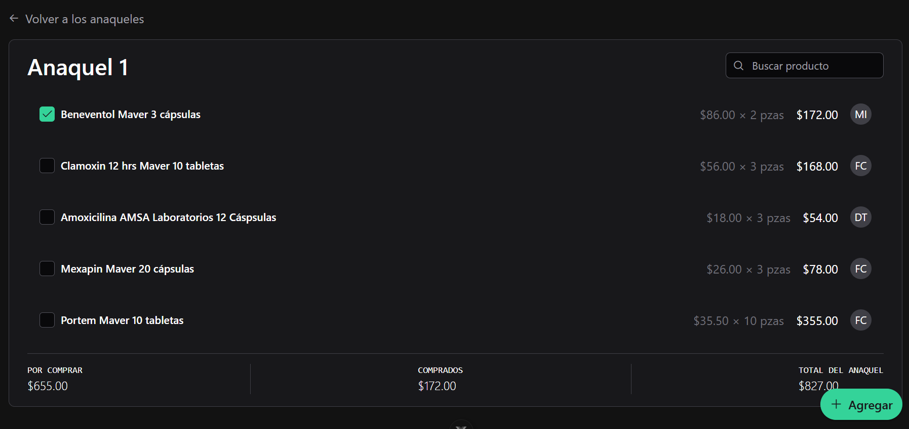
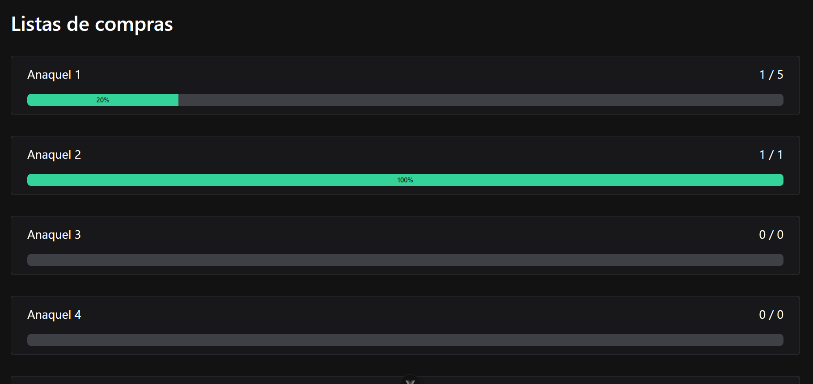
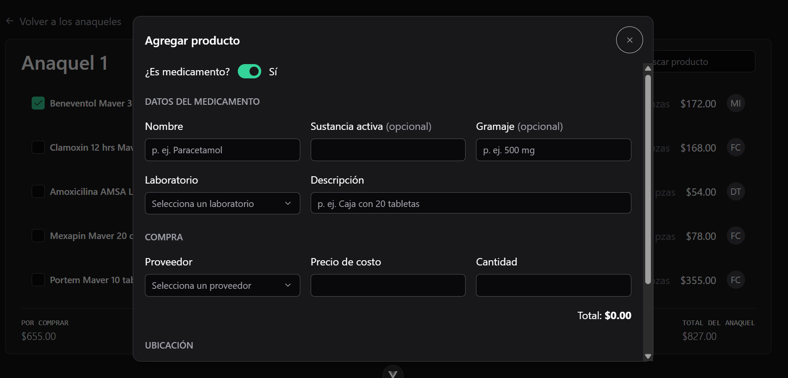

# Lista de resurtido farmacéutico

Lista de resurtido digital para farmacias de barrio pequeñas.

**Demo en línea:** próximamente en `lista-resurtido.santiagojmz.com`



## El problema

En nuestras farmacias familiares, cada domingo hacíamos a mano la lista de lo que se terminó en la semana. Por cada producto anotábamos nombre, gramaje, marca, precio y con qué proveedor comprarlo, y al final sumábamos todo para saber el presupuesto de resurtido de la semana.

Esta app guarda los productos con su precio de costo y su proveedor, los organiza por sector (el anaquel donde están) y calcula los totales sola. Menos tiempo escribiendo, menos errores al sumar y la lista siempre a la mano.

## Funcionalidades

- Sectores (anaqueles) con su avance: cuántos productos ya se compraron y el porcentaje.
- Lista de productos por sector, con laboratorio, precio de costo × cantidad y proveedor.
- Agregar productos desde un formulario: los laboratorios, proveedores y anaqueles se cargan del servidor.
- Editar y eliminar productos desde el menú de cada renglón; eliminar pide confirmación.
- Marcar productos como comprados al instante; si el servidor falla, el cambio se revierte y se avisa.
- Totales por anaquel: por comprar, comprados y total.
- Búsqueda de productos que ignora acentos y mayúsculas ("acido" encuentra "Ácido").
- Estados de carga y de error en cada pantalla, y diseño adaptado a celular.

| Anaqueles con su avance | Agregar un producto |
| --- | --- |
|  |  |

## Tecnologías

- **Vue 3** (Composition API + `<script setup>`) con **TypeScript**
- **PrimeVue** para componentes de interfaz, elegido por ser más ligero que Quasar o Vuetify
- **Tailwind CSS**
- **Vue Router**
- **Vite**
- Servidor (backend): **Express.js** + **MySQL** (repositorio aparte)

## Cómo correrlo

Requisitos: Node.js 22.18+ o 24.12+, y el backend corriendo.

```sh
npm install
cp .env.example .env    # llena las variables de la tabla de abajo
npm run dev
```

| Variable               | Descripción                                                                                   | Ejemplo                 |
| ---------------------- | --------------------------------------------------------------------------------------------- | ----------------------- |
| `VITE_API_URL`         | URL base del API (Express)                                                                    | `http://localhost:3000` |
| `VITE_PRIMEUI_LICENSE` | Clave de licencia de PrimeVue 5. La licencia Community es gratuita y se obtiene creando una cuenta en [PrimeStore](https://primeui.store/). Sin ella, la app muestra el aviso "Invalid PrimeUI License". | `tu-clave`              |

Otros comandos:

```sh
npm run build        # revisa tipos y compila para producción
npm run type-check   # solo revisa tipos
```

## Estructura

```
src/
├── pages/        pantallas (lista de anaqueles y productos de un anaquel)
├── components/   piezas de interfaz (listas y formulario)
├── services/     llamadas al API; los componentes nunca usan fetch directo
├── helpers/      funciones puras (formato de moneda, iniciales, búsqueda sin acentos)
├── interfaces/   tipos de TypeScript
└── mocks/        respuestas de ejemplo del API, para trabajar sin backend (en preparación)

docs/capturas/    imágenes de este README
```

## Próximos pasos

Este es el primer módulo de un punto de venta pensado para el flujo de trabajo de una farmacia de barrio. La idea es que la lista de resurtido se genere sola a partir de las ventas, sin olvidos ni costos desactualizados.

- [x] ~~Agregar productos~~
- [x] ~~Editar y borrar productos~~
- [ ] Crear, editar y borrar anaqueles
- [ ] Vista de compras agrupada por proveedor, con el total a pagar en cada uno
- [ ] Modo sin backend con datos de ejemplo (MSW)
- [ ] Pruebas automatizadas y linter
- [ ] Demo en línea
- [ ] Conectar con el módulo de ventas
